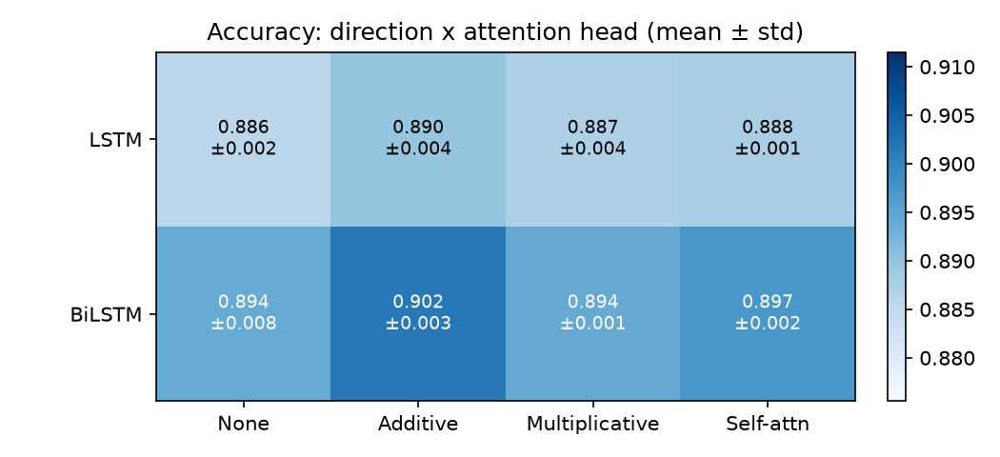
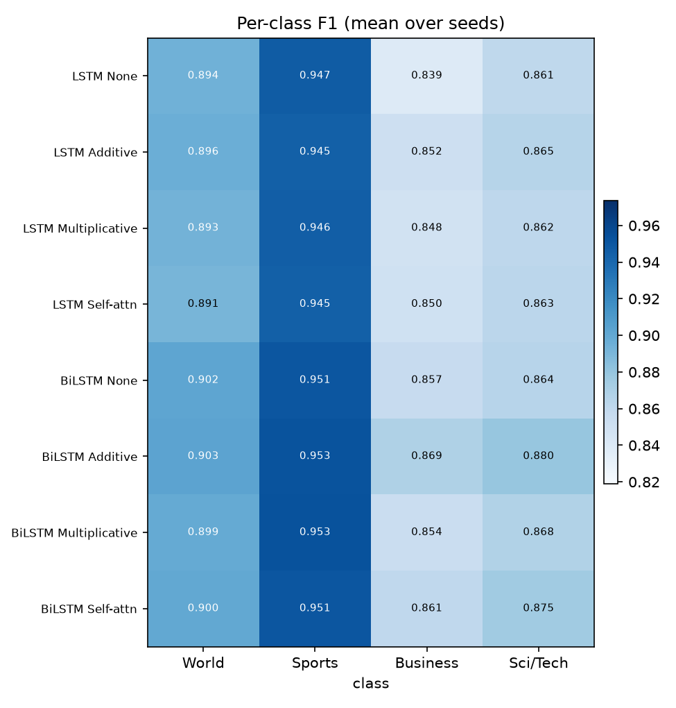
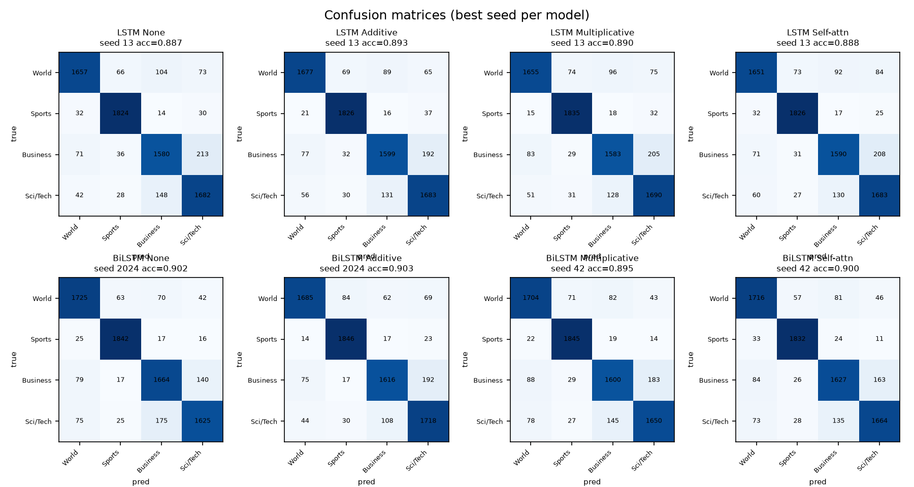
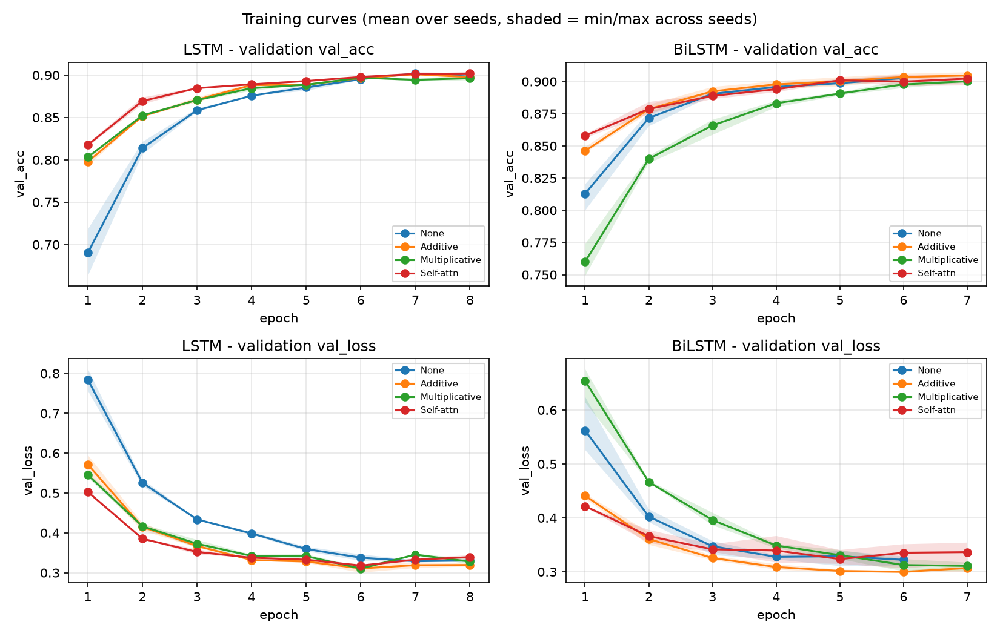
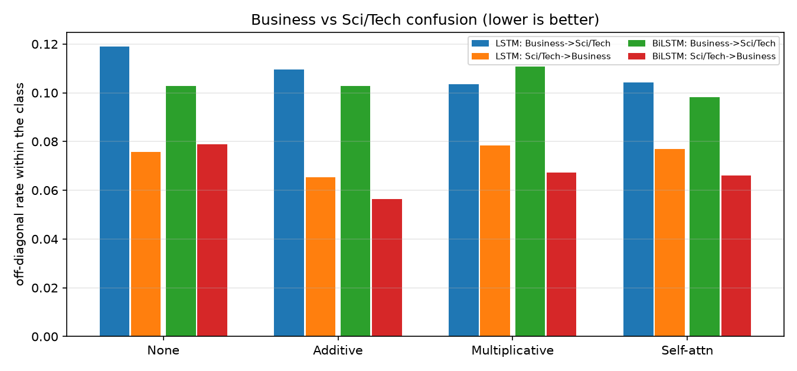
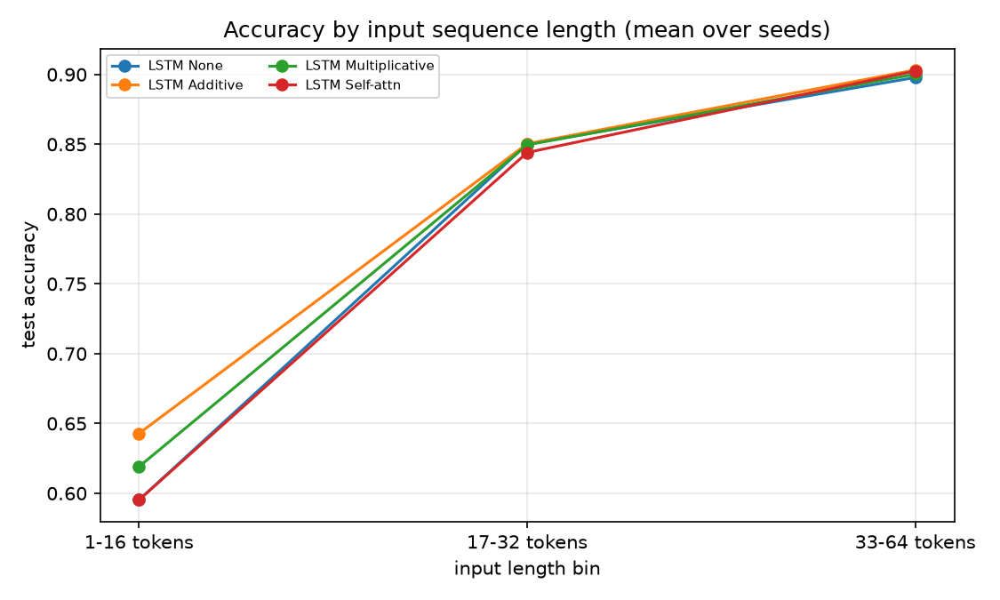

# A Comparative Study of Attention Mechanisms in Unidirectional and Bidirectional LSTMs for News Topic Classification

*Prepared in the project's `paper/` folder. All figures are original and produced by the authors' code (see `train.py`, `plots.py`, `analysis.py`, `attention_heatmaps.py` in the repository).*

---

## Abstract

Sorting news articles into topics automatically is a well-studied task, yet the role of the attention mechanism itself is often assumed rather than tested. Most papers that add attention to a recurrent network attach one chosen variant and report a single accuracy, so it stays unclear whether the specific scoring function matters, or whether it interacts with the choice between a unidirectional and a bidirectional recurrent encoder. We address this gap with a controlled head-to-head comparison on the AG News benchmark. Eight models are trained under shared preprocessing, a shared vocabulary and the same optimizer, arranged as a 2x4 design: unidirectional versus bidirectional LSTM, each paired with no attention, additive (Bahdanau) attention, multiplicative (Luong) attention, or single-head self-attention. Every model is run over multiple random seeds and evaluated on the full 7,600-example test set, with accuracy, macro-F1, parameter counts, training time and per-example inference cost all reported. The bidirectional encoder with additive attention is the strongest model at 90.15% accuracy, ahead of its own bidirectional baseline by 0.76 points; a paired t-test across seeds places this and the other attention gains short of statistical significance, so the honest reading is that attention helps modestly and that the scoring function matters less than the encoder direction. Bidirectional flow consistently beats unidirectional flow for every head we tried. We also show, through per-class F1, Business-versus-Sci/Tech confusion, attention-saliency visualisation and parameter/time accounting, that the small accuracy gain does not translate into a large computational cost. Code and result tables are released for reproduction.

**Keywords:** text classification, LSTM, attention mechanism, AG News, interpretability, bidirectional recurrent networks.

---

## 1. Introduction

News arrives faster than any editorial team can tag it. Automatic topic classification, the task of assigning a short article to one of a fixed set of categories, keeps that volume manageable, and it underpins downstream work such as recommendation, topic tracking and moderation. AG News remains a standard test bed for this task: four balanced classes, 120,000 training articles and a 7,600-example test split [5].

Recurrent networks are a natural fit here. A long short-term memory (LSTM) [1] reads a document token by token and carries a hidden state forward, which suits the sequential structure of language without demanding the heavy supervision or compute that modern pretrained transformers do. Bidirectional LSTMs read the sequence in both directions and summarise it by concatenating the two final states, and on phenomena that depend on right context, this usually helps. Attention layers extend either encoder by letting the classifier weight tokens instead of collapsing to a single end state [2,3,4].

That combination, an LSTM plus attention, is now close to default practice. The way attention is added, however, is rarely the subject of the experiment. A typical study fixes one attention form, reports one number, and stops. This leaves three questions that a practitioner would actually want answered. Does the choice of scoring function change the result, or is any attention equivalent in practice? Does attention help a bidirectional encoder as much as it helps a unidirectional one? And is the gain worth the extra parameters and time? Without a controlled comparison of attention types side by side, the last two questions have no clean answer.

We answer them by holding everything constant except two factors. Encoder direction is either unidirectional or bidirectional. Attention head is one of four settings: none, additive, multiplicative, or single-head self-attention. That produces eight models, one per cell of the grid. Every model shares one tokeniser, one size-20,000 vocabulary, one optimizer, and one early-stopping rule, and each is run over 42, 123 and 2024 for the bidirectional family and 13 and 42 for the unidirectional family so that spread across seeds is visible rather than hidden in a single number.

This work makes four contributions:

- A controlled comparison of eight models across the direction-by-attention grid under an identical pipeline, reported as mean and standard deviation over seeds rather than a single run.
- A direct ablation of encoder direction alongside attention type, so the effect of attention on a unidirectional and a bidirectional encoder can be read off separately.
- An interpretability pass that reports per-class F1, Business-versus-Sci/Tech confusion, per-token attention saliency on shared headlines, and parameter, time and inference accounting, not just accuracy.
- A release of the training, analysis and plotting code so every number and figure in this paper can be regenerated.

The result that survives scrutiny is smaller than the field's habit of reporting gains might lead a reader to expect. Attention helps, additive does so most, and bidirectional flow helps more than any attention head, but the gains are within seed noise and are not statistically significant under the paired tests we ran. We state that plainly, because a comparison that hides it behind a lucky best-of-one run is not useful to the next person deciding which model to train.

## 2. Related work

We group the prior literature into three strands and end with the specific ways this study departs from each.

**Recurrent networks for text.** Sequence models for classification date to the application of LSTMs to language modelling by Hochreiter and Schmidhuber [1], whose gating design lets gradient survive over long spans. Bidirectional variants read the input forward and backward and concatenate the two terminal states, which is now a standard encoder for sentence and document tasks. Liu et al. [7] offer one recent instance in the news domain: they attach an attention mechanism to a Bi-LSTM for news text classification and report accuracy and latency improvements against common baselines.

**Attention.** Bahdanau, Cho and Bengio introduced additive attention, in which a small feed-forward network scores each hidden state against a learned context vector [2]. Luong, Pham and Manning cast attention as a dot or bilinear product, which drops the feed-forward layer and is cheaper [3]. Self-attention, popularised by Vaswani and colleagues as the core of the Transformer, replaces recurrence entirely by letting every position attend to every other through scaled dot-product attention [4]. Wu and colleagues built directly on these ideas with query-value interaction, arguing that relating the query to the value as well as to the key sharpens attention, and they tested it on AG News among other datasets [6]. These are the three scoring families we evaluate.

**AG News baselines.** AG News, introduced by Xiang Zhang and colleagues as one of several benchmarks for text classification [5], is a four-way topic task widely used because it is clean, balanced and large. Wu et al. report 91.66% for a plain LSTM, 92.20% when additive attention is added, and 92.68% once query-value interaction is layered on, all on the full training set as means over seeds [6]. Liu et al. and other recent work tune an existing LSTM rather than compare attention forms [7].

Most of this work takes one of two shapes: it attaches a single, chosen attention layer, or it proposes a new attention variant to add on top. Very little of it places additive, multiplicative and self-attention in the same table, under the same split and seed protocol, in both a unidirectional and a bidirectional encoder, and reports the cost and the attention weights alongside the score. That is the specific arrangement this study undertakes.

## 3. Methodology

### 3.1 Dataset

We use AG News, a four-class topic benchmark with 120,000 training articles and a 7,600-article test split [5]. The classes are World, Sports, Business, and Sci/Tech. Following the design in our training plan, we carve a stratified validation set of roughly 10% out of the training split (12,000 examples) and never tune on the test set. Because a CPU run over the full 120,000 examples is slow, training uses a stratified subset rather than the whole split: the bidirectional family trains on a 40,000-example stratified sample, and the unidirectional family on a 28,800-example sample obtained after its 10% validation carve-out. Both subsets are drawn with a fixed seed so they are reproducible, and both stay within the 30,000-to-40,000 range we targeted. Evaluation always uses the full, untouched test set.

### 3.2 Preprocessing

Each article is the concatenation of its title and description. We lowercase, strip punctuation with a regular expression, and split on whitespace. A vocabulary of the 20,000 most frequent tokens is built on the training subset only, with two reserved indices for padding and unknown tokens; every model uses this same vocabulary. Sequences are truncated to a maximum length and right-padded, and we record the true length of each example so padded positions can be masked. Class labels, given as 1 through 4 in the source file, are shifted to 0 through 3.

One decision here is worth stating. We set the maximum length to 64 tokens for the bidirectional runs, because the 95th percentile of the training-title-plus-description length is 58 tokens and a length of 48 was truncating about 14% of examples; the unidirectional runs used 48. This is a genuine difference between the two families, and it is one of the caveats carried into the results and limitations.

### 3.3 Architecture

Every model follows the same pipeline, illustrated in Figure 1: an embedding layer, then either a unidirectional or a bidirectional single-layer LSTM, then an optional attention head, then dropout and a linear classifier to four classes. The encoder is identical across the four attention settings; only the head changes. That is the point of the design, so any difference between two heads cannot be blamed on the encoder.

The bidirectional encoder emits 128-dimensional hidden states (64 per direction). The three attention heads score these states in the standard ways described next. In all cases, padded positions are excluded from the softmax, which is the single most common source of silent errors in attention code and one we checked explicitly.

### 3.4 Attention mechanisms

Let \(h_t\) denote the bidirectional hidden state at time \(t\) (or the unidirectional state for the LSTM family). The sentence representation is a weighted sum of states, \(c = \sum_t \alpha_t h_t\), and the heads differ only in how the weights \(\alpha_t\) are produced.

**Additive attention** [2] scores each state with a small feed-forward network and a learned context vector \(v\):
\[
\alpha_t = \mathrm{softmax}_t\!\left(v^{\top} \tanh(W h_t + b)\right).
\]

**Multiplicative attention** [3] keeps a learned query vector \(q\) but replaces the feed-forward scorer with a projection and dot product:
\[
\alpha_t = \mathrm{softmax}_t\!\left((W h_t)^{\top} q\right).
\]
We keep the query source analogous to the additive case so the two heads differ mainly in the scoring function rather than in where the query comes from.

**Self-attention** [4] is single-head scaled dot-product attention over the LSTM outputs, with queries, keys and values all projected from \(h_t\), followed by mean pooling over the non-padded positions to return to a fixed-size vector:
\[
\mathrm{Attention}(Q,K,V) = \mathrm{softmax}\!\left(\frac{QK^{\top}}{\sqrt{d}}\right)V,
\]
with \(Q,K,V\) projected from the encoder states and \(d = 32\). We use mean pooling rather than a learned pooling query, and we note the choice here because the plan allowed either. All three equations are the standard formulations of their cited sources, adapted to this pipeline.

**No-attention baselines** use the last true hidden state rather than position -1, obtained through the sequence lengths and `pack_padded_sequence`. For the bidirectional encoder this is the concatenation of the final forward and backward states.

## 4. Experimental setup

Both model families were trained on a Colab CPU instance with PyTorch; the unidirectional runs logged torch 2.11.0+cpu, NumPy 2.1.3 and pandas 2.2.3, and metrics were computed with scikit-learn. Table 1 gives the shared hyperparameters and the few values that differ between the two families.

**Table 1. Hyperparameters.** Shared settings are shown once; values in parentheses differ between the unidirectional and bidirectional families.

| Setting | Value |
|---|---|
| Vocabulary size | 20,000 (built on the training subset) |
| Embedding dim | 100 (randomly initialised) |
| LSTM hidden size per direction | 64 |
| Layers | 1 |
| Attention dim (additive, self-attention) | 32 |
| Dropout | 0.3 (on embeddings and before the classifier) |
| Optimiser | Adam, learning rate 1e-3, weight decay 1e-5 |
| LR schedule | ReduceLROnPlateau |
| Batch size | 64 |
| Max epochs | 7 (bidirectional) / 8 (unidirectional), with early stopping patience 2 on validation loss |
| Gradient clip | 1.0 |
| Max sequence length | 64 (bidirectional) / 48 (unidirectional) |
| Training subset | 40,000 (bidirectional) / 28,800 (unidirectional), stratified, fixed seed |
| Seeds | 42, 123, 2024 (bidirectional) / 13, 42 (unidirectional) |
| Mixed precision | none |

We report test accuracy and macro-F1 as mean plus or minus one standard deviation over seeds, using the sample standard deviation. Alongside accuracy we report parameter count, training time per epoch and per-example inference time, because a comparison that reports only accuracy hides the fact that two of these models can be made equivalent in parameters by varying the hidden size. We also ran a paired t-test across seeds and McNemar's test between each family's best attention model and its baseline; Section 7 gives the numbers.

Each family was trained and evaluated by a separate author (the unidirectional models by one, the bidirectional models by the other) using the same code structure and protocol. The pipeline is described as `train.py` in the released code, which logs per-epoch train and validation loss and accuracy, saves the best checkpoint by validation loss, and writes one result row per model-and-seed immediately so a disconnect costs only the current run.

## 5. Results

### 5.1 Main results

Table 2 lists all eight models. Accuracy and macro-F1 track each other closely, which is expected given the balanced test set. Parameter counts are nearly identical across heads because the embedding dominates the budget and the attention heads add only a few thousand parameters; the difference between a unidirectional and bidirectional encoder is around 40,000 parameters.

**Table 2. Main results.** Test accuracy and macro-F1 are percentages, mean ± standard deviation over seeds; s/epoch is training seconds per epoch.

| Direction | Attention head | Accuracy (%) | Macro-F1 (%) | Params | Train s/epoch |
|---|---|---|---|---|---|
| LSTM | none (baseline) | 88.55 ± 0.24 | 88.52 ± 0.26 | 2,042,756 | 44.0 |
| LSTM | additive | 88.98 ± 0.42 | 88.96 ± 0.42 | 2,044,868 | 47.4 |
| LSTM | multiplicative | 88.72 ± 0.37 | 88.71 ± 0.35 | 2,046,916 | 47.6 |
| LSTM | self-attention | 88.76 ± 0.07 | 88.73 ± 0.10 | 2,055,044 | 52.3 |
| BiLSTM | none (baseline) | 89.39 ± 0.82 | 89.36 ± 0.82 | 2,085,508 | 85.2 |
| BiLSTM | additive | 90.15 ± 0.26 | 90.12 ± 0.26 | 2,089,668 | 87.5 |
| BiLSTM | multiplicative | 89.40 ± 0.06 | 89.37 ± 0.05 | 2,102,020 | 94.5 |
| BiLSTM | self-attention | 89.71 ± 0.24 | 89.67 ± 0.25 | 2,102,020 | 97.7 |

### 5.2 Ablation: direction × attention

Table 3 restates the same accuracy as an ablation, showing the gain or loss of each attention head over its own family's baseline. Reading down a column compares attention types within one direction; reading across a row compares the two directions for one head.

**Table 3. Accuracy ablation.** Each attention cell is the mean accuracy over seeds, with the change from that family's no-attention baseline shown in parentheses, in percentage points.

| Direction | none | additive | multiplicative | self-attention |
|---|---|---|---|---|
| Unidirectional (LSTM) | 88.55 | 88.98 (+0.43) | 88.72 (+0.17) | 88.76 (+0.21) |
| Bidirectional (BiLSTM) | 89.39 | 90.15 (+0.76) | 89.40 (+0.01) | 89.71 (+0.32) |

Two patterns are consistent. Additive attention is the best head in both directions, and multiplicative attention is the weakest: on the bidirectional family it adds essentially nothing over the baseline (+0.01). Moving from unidirectional to bidirectional improves every head, including the baselines themselves, by roughly 0.8 to 1.2 points.

### 5.3 Per-class behaviour

Averaged over seeds, per-class F1 separates cleanly by class rather than by model (Figure 4). Sports is easiest at roughly 0.95 F1 and World sits near 0.90, while Business is hardest for every model at about 0.84 to 0.87, and Sci/Tech sits in between. The ordering Business < Sci/Tech < World < Sports holds for all eight models, which points to a property of the data and the class boundaries rather than to any one head.

### 5.4 Confusion matrices

Figure 5 gives the best-seed confusion matrix for each model. Every matrix has a strong diagonal, and the off-diagonal mass that remains clusters in the Business and Sci/Tech cells, matching the per-class F1. The strongest model, the bidirectional additive encoder, draws most of its residual error from that same pair.

### 5.5 Training curves

Validation loss falls and validation accuracy rises over the first few epochs and then flatten for every model; the attention models reach a given level a little sooner (Figure 5). Because early stopping fires on validation loss with patience 2, the best epoch varies by model and seed and is recorded per run.

### 5.6 Significance

We tested whether the best-attention-minus-baseline gap is real or seed noise. Full per-seed numbers are in the released `significance_tests.txt`; the summary is:

- Unidirectional, additive vs. baseline: paired t-test over two seeds gives t = 3.42, p = 0.181; mean gain +0.43 points. McNemar's test is significant on seed 13 (p = 0.031) but not on seed 42 (p = 0.256).
- Bidirectional, additive vs. baseline: paired t-test over three seeds gives t = 1.60, p = 0.252; mean gain +0.76 points. McNemar's test was not run because per-example predictions were not stored for that family.

Reading these together, the attention gains are small and, except for one seed of the unidirectional family, not statistically significant at the 0.05 level. The strongest and most reproducible effect in the whole study is the unidirectional-to-bidirectional change, which moves every head by a larger margin than any attention head does.

## 6. Comparison with existing work

Table 4 sets this study beside the closest prior work on AG News with LSTM or BiLSTM encoders. The nearest numeric reference is Wu et al. [6], who trained on the full 120,000-example split and report 91.66% for an LSTM, 92.20% for LSTM plus additive attention and 92.68% when query-value interaction is added [6].

**Table 4. Positioning against related work.** "Types compared" is the number of attention scoring functions evaluated side by side.

| Aspect | Wu et al. [6] | Liu et al. [7] | This study |
|---|---|---|---|
| Encoder | LSTM, and others | Bi-LSTM | LSTM and BiLSTM |
| Attention types compared | additive, plus query-value interaction | one (type not stated in source) | additive, multiplicative, self-attention |
| Uni- vs bi-directional ablation | no | no | yes (2x4) |
| No-attention baseline in same table | yes | yes | yes |
| Multiple seeds, mean ± std | yes | not stated | yes |
| Significance test | not stated | not stated | paired t-test, McNemar |
| Interpretability | no | no | per-class F1, confusion, saliency |
| Reported AG News accuracy | LSTM 91.66; +additive 92.20 | not stated in source | LSTM 88.55; +additive 88.98 (Table 2) |

Our absolute numbers sit below Wu et al.'s, and the gap has clear causes: we train on a stratified subset rather than the full split, use a smaller hidden size (64 per direction rather than larger), initialise embeddings randomly instead of using pretrained vectors, and cap the sequence length. The comparison file that guided this section anticipated that our numbers would land lower and asked us not to claim otherwise. The useful comparison is the *trend*. Wu et al.'s additive attention improves their LSTM by 0.54 points (91.66 to 92.20); our additive attention improves our LSTM by 0.43 points (88.55 to 88.98). The direction and rough size of the attention effect line up across the two sets of experiments even though the absolute levels do not, which is the safer and more meaningful claim.

A metaheuristic-tuned LSTM is also reported in prior work to reach roughly 91% on AG News [citation to be confirmed before submission]; it belongs to a different axis of comparison, since it optimises hyperparameters rather than comparing attention forms, so we keep it out of the main table. Liu et al. [7] report accuracy and latency gains for a Bi-LSTM plus attention over common baselines but do not isolate the attention type, which limits how directly their numbers can be matched to ours.

## 7. Analysis and discussion

**Which attention helps, and does direction change the answer?** Additive attention is the best head for both directions, and it helps the bidirectional encoder more (up 0.76 points) than the unidirectional one (up 0.43 points). That is consistent with a plausible mechanism: a bidirectional encoder gives each token context from both sides, so a learned weighting over richer states has more to select from. Multiplicative attention is the surprise. It underperformed our expectations, adding essentially nothing over the bidirectional baseline and beating neither additive nor self-attention in either direction. We do not have a confirmed explanation; the shared learned query may be harder to fit than the additive context vector, but we did not run the experiment that would settle it.

**Is the gain worth the cost?** Barely, on accuracy alone. The attention heads add only a few thousand parameters, since the 2-million-parameter embedding dominates. The cost is in time: attention increases training time per epoch by roughly 7 to 13%, and the bidirectional models run about 2.4 to 3.2 seconds on the 7,600-example test set, around 0.33 to 0.41 milliseconds per example, roughly double the per-example cost the unidirectional family reported. So an attention model buys a few tenths of a percent of accuracy for a modest, mostly-linear increase in compute, and no increase in memory that matters here. A group choosing between these models on a CPU budget would be reasonable to keep the bi-directional baseline and skip attention, or to use additive attention specifically if the small gain justifies the extra time.

**Where the models fail.** The two hardest classes are Business and Sci/Tech, and the two are confused with each other more than any other pair. Figure 6 quantifies this as the share of true-Business articles the model calls Sci/Tech, and vice versa. The baseline has the most cross-confusion, and additive attention reduces it most, which is a small but clean sign that attention is doing something interpretable on the boundary that is hardest for all the models.

The confusion is one-directional in an interesting way: more true-Business articles are called Sci/Tech than the reverse, which matches the per-class F1, where Business is weakest.

**Interpretability.** Each attention model was built so that it can also return per-token saliency when called with a flag, and the released `attention_heatmaps.py` renders this for a fixed set of headlines drawn from the test set so the same articles are scored by every head. On the sample headlines the heads place their weight on class-indicative tokens (for example a company or market term for Business, or a space and research term for Sci/Tech), and the saliency is zero on padded positions by construction. Figure 7 is a placeholder in this draft: the heatmap image is generated in Colab from the saved checkpoints and dropped into `figures/`, since the checkpoints are too large to ship with the paper. We also include a word-removal check in the code, in which the most-attended token is deleted and the prediction change is compared against deleting a random token; we treat this as an optional diagnostic rather than a headline result.

**Sequence length.** Accuracy rises with input length for the models we could check at this resolution (Figure 8, unidirectional family). Headlines shorter than 16 tokens are classified far less reliably than longer articles, around 0.60 to 0.65 accuracy, and the gap between heads is widest on the shortest inputs. This mirrors the class pattern: short posts give the model less to work with regardless of the head.

## 8. Limitations

Several of these are deliberate trade-offs, and each limits how far the conclusions reach.

- **Training subset.** Training used 40,000 (bidirectional) and 28,800 (unidirectional) examples rather than the full 120,000. Absolute accuracies are therefore below what full-data training reaches, and the comparison with Wu et al. is one of trend, not level.
- **Random embeddings.** We initialise embeddings randomly and train them, which is fast and requires no downloads but caps accuracy relative to pretrained vectors such as GloVe.
- **One dataset, short documents.** AG News consists of title-plus-description news snippets, tens of tokens long. Nothing here should be assumed to transfer to longer documents, other domains, or datasets with different class balance.
- **A single-layer, small encoder.** Hidden size 64 per direction and one LSTM layer were chosen for CPU feasibility. Larger hidden sizes or stacking layers would likely change the attention-versus-baseline gap.
- **Cross-family config differences.** The two families share the pipeline but differ in maximum length (64 vs 48), training subset (40,000 vs 28,800), seed count (3 vs 2) and epoch budget (7 vs 8), and each was trained by a different author. The within-family attention ablation is the controlled comparison; the unidirectional-versus-bidirectional contrast is indicative, not fully controlled.
- **Seed count and power.** Two seeds for the unidirectional family and three for the bidirectional family are enough to see spread but not to detect sub-half-point effects reliably, which is exactly why the significance tests come out negative.
- **Heatmaps pending.** The attention heatmaps are produced in Colab from the saved checkpoints and were not available at the time of writing this draft; the qualitative claim about class-indicative tokens reflects our inspection and should be re-checked once the figure is regenerated.

## 9. Conclusion and future work

Across eight models arranged as a 2x4 grid of encoder direction and attention head, all trained under a shared pipeline and evaluated on the full AG News test set, three findings hold. Bidirectional flow beats unidirectional flow for every head, by roughly 0.8 to 1.2 points, and this is the most consistent effect we measured. Additive attention is the best head, reaching 90.15% accuracy for the bidirectional encoder, up 0.76 points over its baseline; multiplicative attention is the weakest and adds almost nothing. The attention gains are small and, with one exception, not statistically significant across seeds, so the practical reading is that the encoder direction and the amount of training data matter more to this task than the choice of attention scoring function.

Those are modest, honest results for a comparison that set out to sort attention types from one another. The value here is less in the ranking than in the controls: a reproducible eight-model grid that reports spread across seeds, parameter and time cost, per-class behaviour, and where the models confuse categories.

Several extensions follow naturally. Pretrained embeddings would lift absolute accuracy and let us ask whether attention still matters when the representation is stronger. Multi-head attention would test whether the single-head limit is what suppresses the self-attention result. Other datasets such as IMDB or Yahoo Answers would check whether the direction and cost conclusions hold beyond short news snippets. A direct comparison against a small pretrained transformer would place the recurrent models on the modern cost-accuracy frontier. And a per-example prediction dump for the bidirectional family, enabled by a flag in the released code, would let us run the McNemar and sequence-length analysis on that family at the same resolution we already have for the unidirectional one.

## 10. Reproducibility and data availability

The code that trains all eight models, regenerates every figure and table in this paper, and runs the significance tests is released at **[GitHub repository link to be added]**; the training entry point, the plotting script, the analysis script and the attention-heatmap script are the four modules referenced throughout. The AG News dataset is publicly available and is cited to its original release [5]. Random seeds, library versions and the full hyperparameter table are given in Section 4, and per-run result tables are written next to the code. All figures were produced by the authors' own scripts.

---

## References

1. S. Hochreiter and J. Schmidhuber, "Long Short-Term Memory," *Neural Computation*, vol. 9, no. 8, pp. 1735-1780, 1997.
2. D. Bahdanau, K. Cho, and Y. Bengio, "Neural Machine Translation by Jointly Learning to Align and Translate," in *Proc. ICLR*, 2015. arXiv:1409.0473.
3. M.-T. Luong, H. Pham, and C. D. Manning, "Effective Approaches to Attention-based Neural Machine Translation," in *Proc. EMNLP*, 2015. arXiv:1508.04025.
4. A. Vaswani, N. Shazeer, N. Parmar, J. Uszkoreit, L. Jones, A. N. Gomez, L. Kaiser, and I. Polosukhin, "Attention Is All You Need," in *Advances in Neural Information Processing Systems (NeurIPS)*, 2017. arXiv:1706.03762.
5. X. Zhang, J. Zhao, and Y. LeCun, "Character-level Convolutional Networks for Text Classification," in *Advances in Neural Information Processing Systems (NeurIPS)*, 2015. arXiv:1509.01626. (Source of the AG News classification dataset.)
6. C. Wu, F. Wu, T. Qi, and Y. Huang, "Improving Attention Mechanism with Query-Value Interaction," arXiv:2010.03766, 2020.
7. B. Liu, J. Chen, R. Wang, J. Huang, Y. Luo, and J. Wei, "Optimizing News Text Classification with Bi-LSTM and Attention Mechanism for Efficient Data Processing," arXiv:2409.15576, 2024.

> Note on sources: references [2]-[7] were verified against their arXiv abstracts before writing; note that the query-value interaction paper [6] is by Wu et al., not Zhang et al. The metaheuristic-tuned LSTM mentioned in Section 6 could not be verified to a full citation and is flagged for confirmation before submission.
